# Catálogo de movimentos

22 movimentos, em 10 categorias. Cada um é um efeito curto e independente, escrito para receber a marca da empresa.

Para ver um deles com a sua marca: `node scripts/renderizar-movimento.mjs --movimento <id> --marca <pasta> --saida teste.mp4`.

## criador

| Prévia | Movimento | Quando usar |
|---|---|---|
| 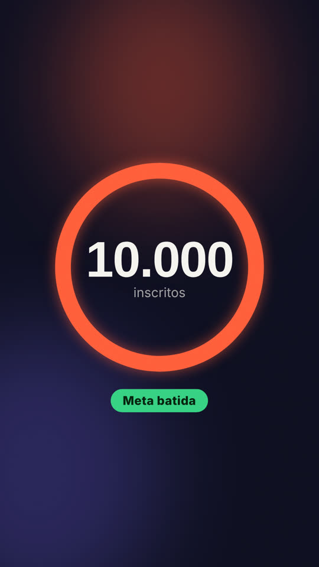 | **Contador de inscritos** (`contador-inscritos`) um anel que se fecha enquanto o número sobe até a meta, terminando em selo de meta batida 3.8 s, 9:16 e 16:9 e 1:1, com versão transparente | quando a pessoa fala de uma marca de audiência ("chegamos a 10 mil inscritos"): o anel fecha na hora em que ela diz o número |
|  | **Legenda cinética** (`legenda-cinetica`) a frase entra palavra por palavra e a palavra que importa ganha a cor de destaque e um pequeno impulso 3.2 s, 9:16 e 16:9 e 1:1, com versão transparente | quando a frase falada precisa de ênfase visual numa palavra só ("isso muda TUDO"): ajuste o tempo para a palavra de destaque coincidir com a fala |

## dados

| Prévia | Movimento | Quando usar |
|---|---|---|
| 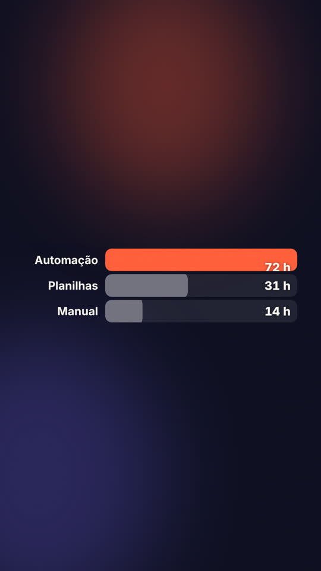 | **Corrida de barras** (`corrida-de-barras`) barras horizontais que crescem juntas, se reordenam pelo valor e deixam o destaque da marca no topo 4.8 s, 9:16 e 16:9 e 1:1, com versão transparente | quando a pessoa compara opções por um número ("manual, planilha e automação: veja a diferença"): as barras crescem enquanto ela compara |
| 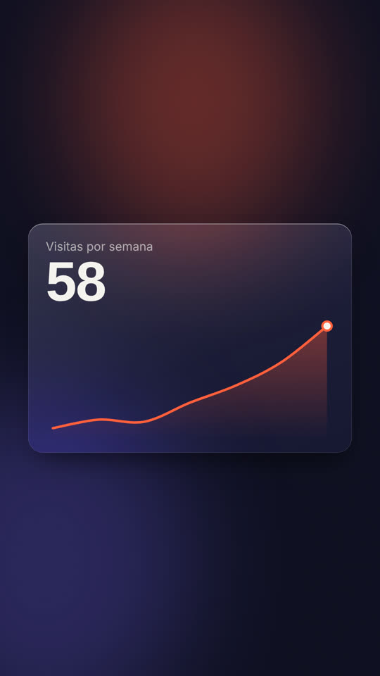 | **Gráfico de linha** (`grafico-de-linha`) uma linha que se desenha ponto a ponto sob um número que acompanha o último ponto 4.6 s, 9:16 e 16:9 e 1:1, com versão transparente | quando a pessoa fala de crescimento ao longo do tempo ("em seis meses, as visitas quadruplicaram"): a linha chega ao fim quando ela diz o resultado |
| 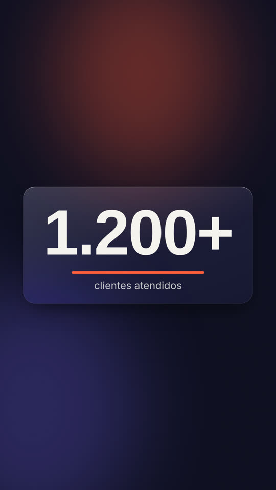 | **Número grande** (`numero-grande`) um painel de vidro com um número enorme que só aparece quando começa a contar, para no valor e recebe um brilho que passa uma vez 3.4 s, 9:16 e 16:9 e 1:1, com versão transparente | quando a pessoa diz um número que prova o argumento ("já são 1.200 clientes"): entre na palavra do número e deixe o contador parar junto com a frase |

## dev

| Prévia | Movimento | Quando usar |
|---|---|---|
| 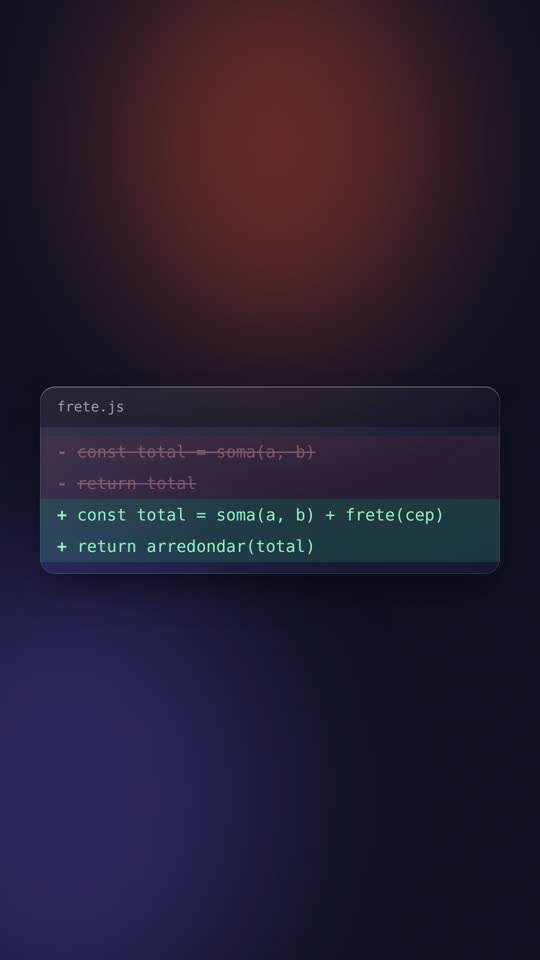 | **Diferença de código** (`diff-de-codigo`) um arquivo em que as linhas antigas ficam riscadas em vermelho e as novas entram em verde 4.2 s, 9:16 e 16:9 e 1:1, com versão transparente | quando a pessoa explica uma correção ou melhoria pequena ("troquei isso por isto"): as linhas novas entram na hora em que ela diz o que mudou |
| 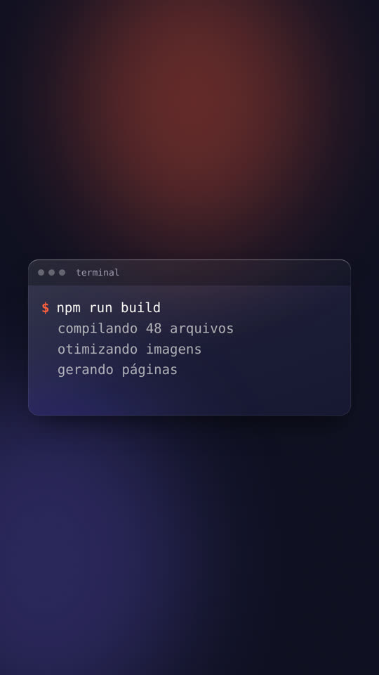 | **Terminal com comando** (`terminal-comando`) uma janela de terminal em que o comando é digitado, a saída aparece linha a linha e a última confirma o resultado 4.4 s, 9:16 e 16:9 e 1:1, com versão transparente | quando a pessoa fala de rodar algo, instalar, publicar ou testar ("rodei o comando e deu certo"): digite no ritmo da fala |

## explicar

| Prévia | Movimento | Quando usar |
|---|---|---|
| 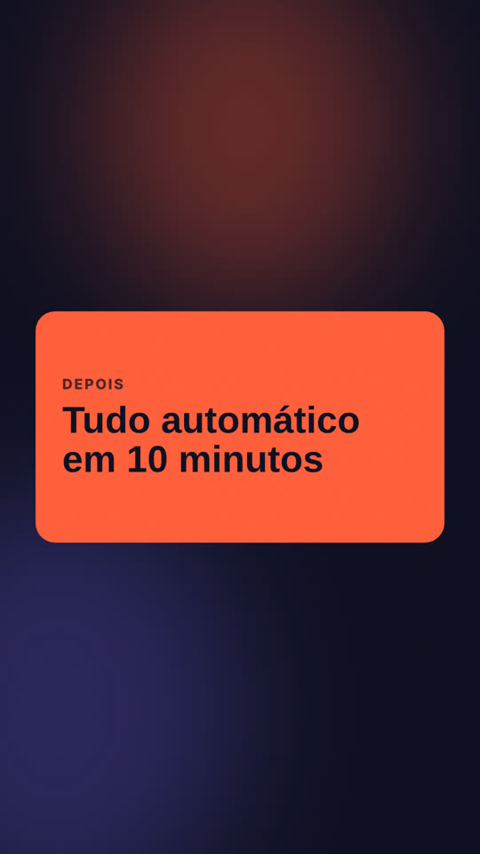 | **Antes e depois** (`antes-e-depois`) dois painéis em que um divisor corre da esquerda para a direita e troca o antes apagado pelo depois em destaque 4.4 s, 9:16 e 16:9 e 1:1, com versão transparente | quando a pessoa contrasta a situação antiga com a nova ("antes eram três horas, agora são dez minutos"): o divisor passa na palavra "agora" |
| 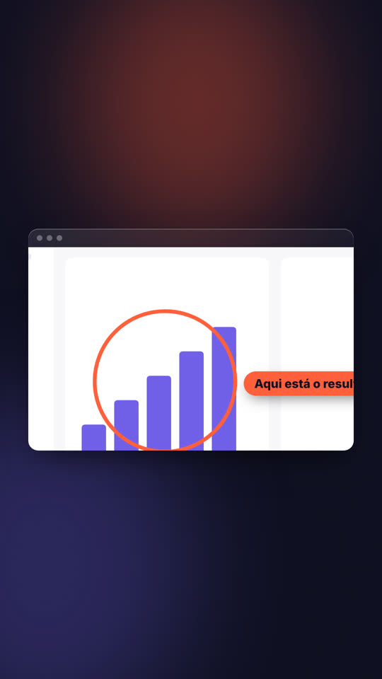 | **Destaque na tela** (`destaque-na-tela`) a tela real do produto numa janela: um anel se desenha sobre o ponto importante, a janela aproxima e um rótulo aponta 4.8 s, 9:16 e 16:9 e 1:1 | quando a pessoa aponta algo numa tela ("olha este número aqui"): use a captura real do produto, nunca uma tela desenhada; o anel fecha na palavra "aqui" |
| 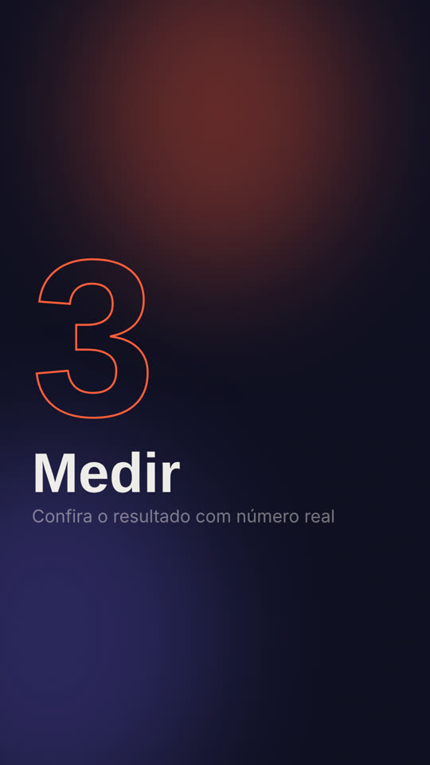 | **Lista numerada** (`lista-numerada`) cada ponto da lista ocupa o quadro inteiro por vez, com o número gigante e o título, em cortes rápidos 5.2 s, 9:16 e 16:9 e 1:1 | quando a pessoa enumera passos ou motivos ("são três etapas: primeiro..."): um ponto por vez, na hora em que ela o diz. Lista de N pontos são N imagens, nunca um cartão com N linhas |

## ia

| Prévia | Movimento | Quando usar |
|---|---|---|
| 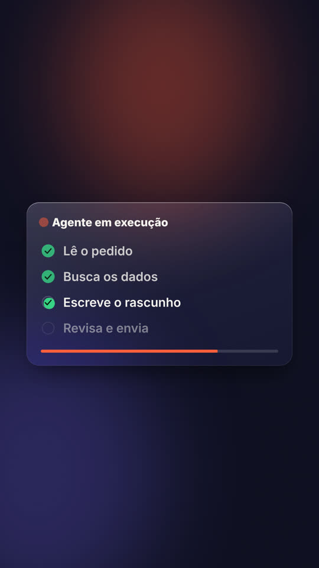 | **Execução de agente** (`execucao-de-agente`) uma lista de passos em que cada um gira, conclui e dá lugar ao próximo, com a barra de progresso embaixo 4.6 s, 9:16 e 16:9 e 1:1, com versão transparente | quando a pessoa explica o que a automação faz sozinha, em etapas ("ele lê o pedido, busca os dados e já envia"): cada passo entra junto com a fala correspondente |
|  | **Pergunta e resposta** (`prompt-e-resposta`) uma caixa de pedido que recebe o texto digitado, é enviada com um toque no botão e abre a resposta palavra por palavra 5.6 s, 9:16 e 16:9 e 1:1, com versão transparente | quando a pessoa mostra o que pediu a uma IA e o que veio de volta ("eu pedi um resumo e veio isto"): digite enquanto ela fala o pedido e abra a resposta quando ela citar o resultado |

## negocios

| Prévia | Movimento | Quando usar |
|---|---|---|
| 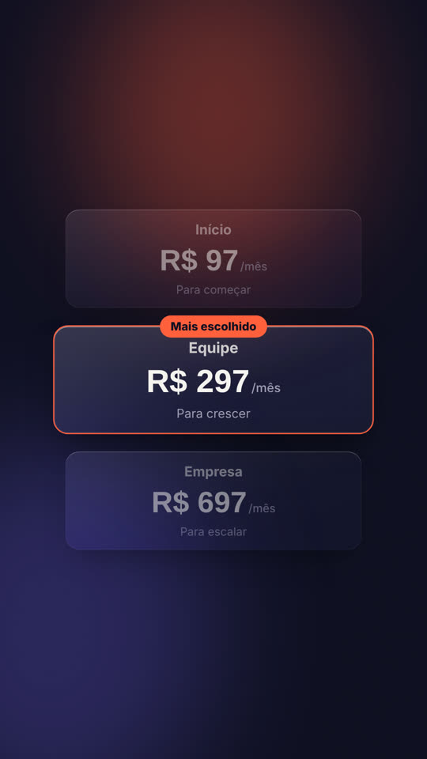 | **Cartões de plano** (`cartao-de-plano`) três planos lado a lado em que o do meio sobe, ganha o selo de mais escolhido e os outros recuam 4.4 s, 9:16 e 16:9 e 1:1, com versão transparente | quando a pessoa apresenta opções de contratação e indica a recomendada ("a maioria escolhe o do meio"): o destaque sobe na palavra da recomendação |
| 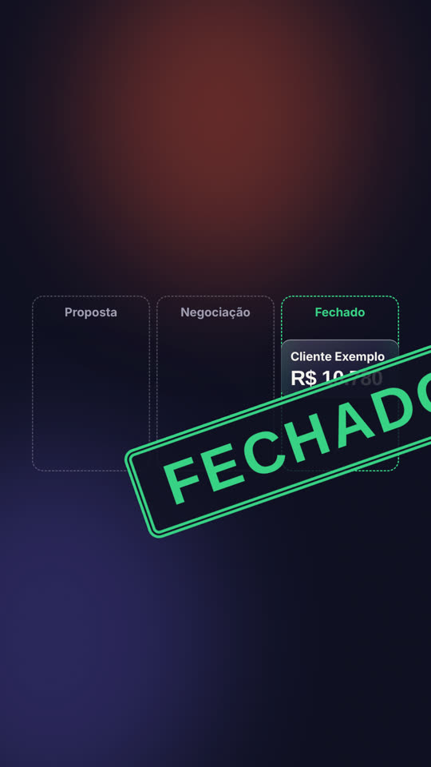 | **Negócio fechado** (`negocio-fechado`) um cartão de cliente que atravessa as três etapas do funil e termina carimbado como fechado, com o valor contado 4.8 s, 9:16 e 16:9 e 1:1, com versão transparente | quando a pessoa conta uma venda ou contrato fechado ("o cliente aprovou na mesma semana"): o carimbo cai na palavra "fechou" |

## papel

| Prévia | Movimento | Quando usar |
|---|---|---|
| 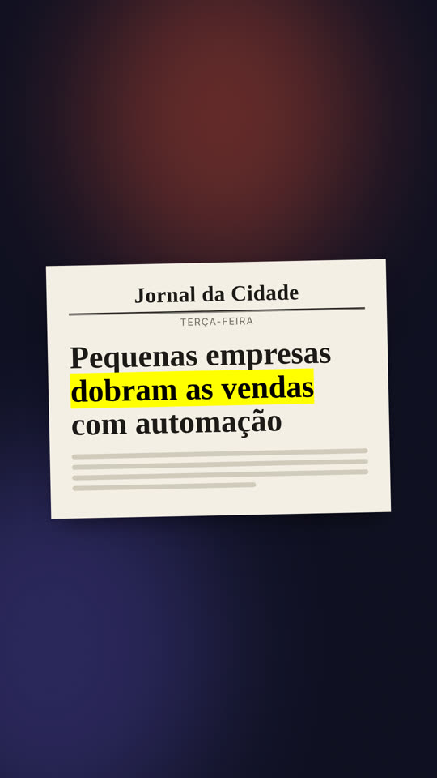 | **Manchete de jornal** (`manchete-de-jornal`) um recorte de jornal cuja manchete é escrita e tem um trecho marcado com marca-texto 4 s, 9:16 e 16:9 e 1:1, com versão transparente | quando a pessoa cita uma notícia, uma frase de imprensa ou algo que saiu sobre o assunto ("saiu até no jornal"): só use manchete que existe de verdade |
| 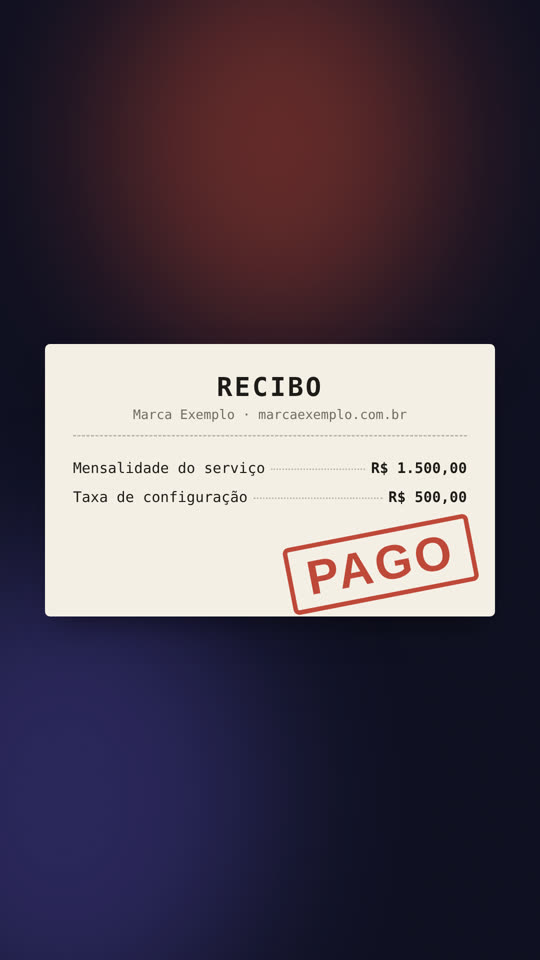 | **Recibo carimbado** (`recibo-carimbado`) um recibo de papel que recebe as linhas uma a uma e leva um carimbo de pago 4.2 s, 9:16 e 16:9 e 1:1, com versão transparente | quando a pessoa fala de pagamento confirmado, comprovante ou conta quitada ("está pago, está resolvido"): o carimbo cai na palavra |

## produtividade

| Prévia | Movimento | Quando usar |
|---|---|---|
| 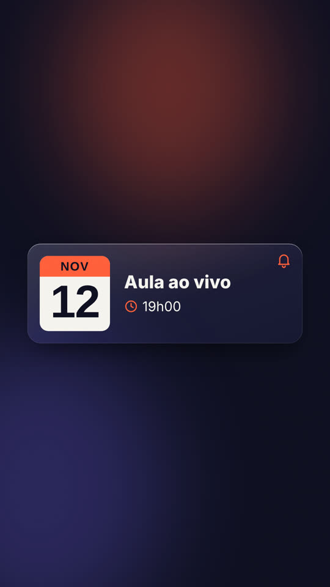 | **Evento de agenda** (`evento-de-agenda`) um cartão de calendário com o dia em destaque, o título e o horário, que termina com um sininho avisando 3.6 s, 9:16 e 16:9 e 1:1, com versão transparente | quando a pessoa marca uma data ou convida para um evento ("quinta, às 19 horas, ao vivo"): o cartão entra na hora em que ela diz o dia |
| 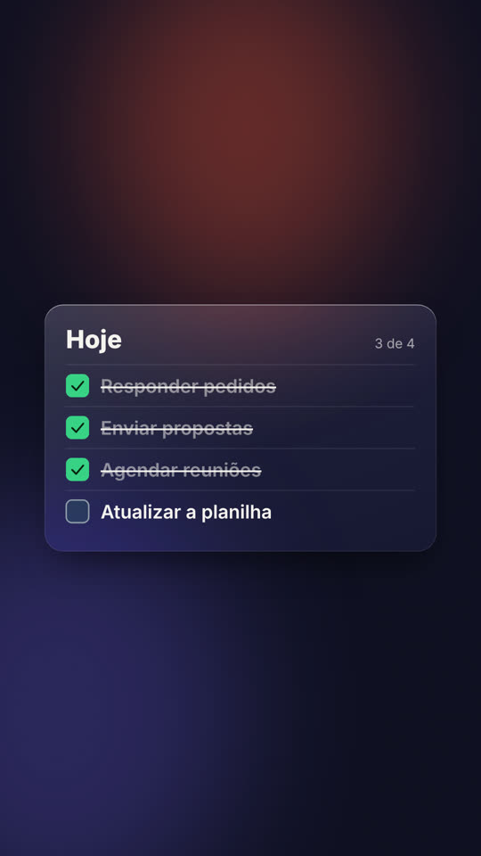 | **Lista de tarefas** (`lista-de-tarefas`) um cartão de tarefas em que cada item é marcado e riscado em sequência, com o contador de concluídas 4.4 s, 9:16 e 16:9 e 1:1, com versão transparente | quando a pessoa lista o que foi resolvido ou o que a automação cuida ("não preciso mais fazer isso, nem isso"): marque um item por frase |

## sistema

| Prévia | Movimento | Quando usar |
|---|---|---|
| 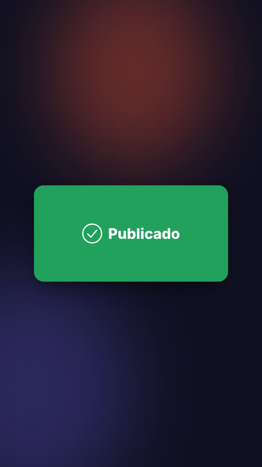 | **Caixa de diálogo** (`caixa-de-dialogo`) uma janela de confirmação em que o cursor atravessa a tela, clica no botão principal e a caixa vira um aviso de feito 4.4 s, 9:16 e 16:9 e 1:1, com versão transparente | quando a pessoa fala de uma decisão tomada com um clique ("é só confirmar e pronto"): o clique acontece na palavra "confirmar" |
| 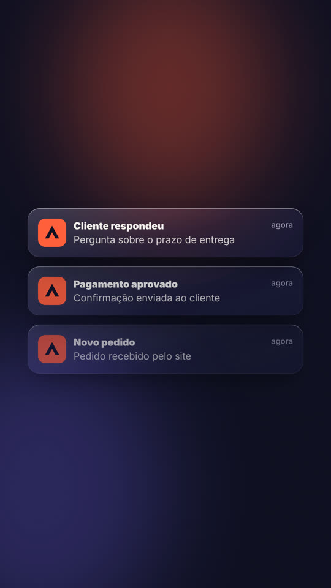 | **Pilha de notificações** (`pilha-de-notificacoes`) notificações de celular que descem uma a uma, empurrando as anteriores para baixo 4.2 s, 9:16 e 16:9 e 1:1, com versão transparente | quando a pessoa fala de avisos que chegam sozinhos ("toda venda me avisa na hora, todo cliente novo também"): uma notificação por frase |

## social

| Prévia | Movimento | Quando usar |
|---|---|---|
| 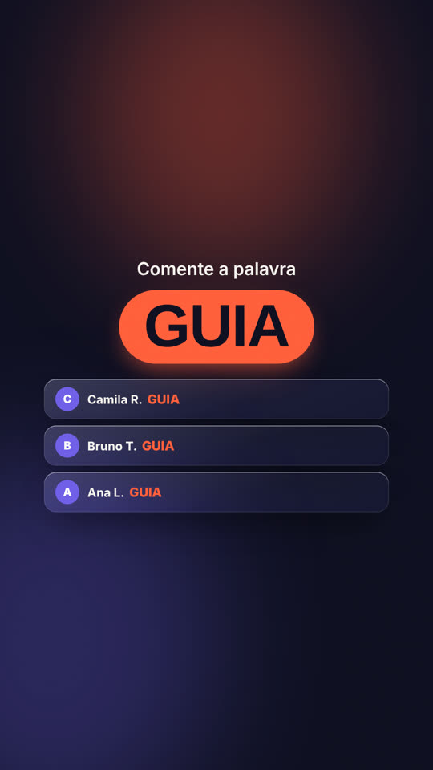 | **Comentário com palavra-chave** (`comentario-palavra-chave`) uma pílula com a palavra-chave e uma fila de comentários que a repetem, entrando em sequência 3.6 s, 9:16 e 16:9 e 1:1, com versão transparente | quando a pessoa pede para comentar uma palavra e recebe algo em troca ("comente GUIA que eu envio"): entre quando ela diz a palavra |
| 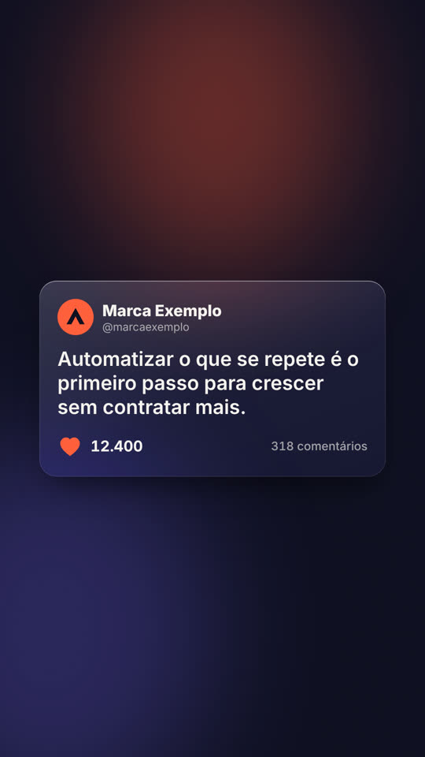 | **Post curtido** (`post-curtido`) um cartão de publicação cujo coração estoura e o contador de curtidas sobe uma 3.6 s, 9:16 e 16:9 e 1:1, com versão transparente | quando a pessoa fala de uma publicação que funcionou ou convida a curtir ("esse post teve mais de 12 mil curtidas"): entre na frase e estoure o coração na palavra-chave |
