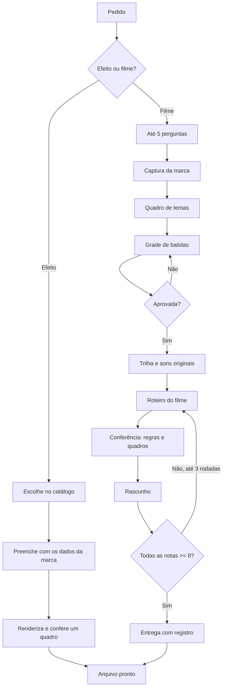

# Manual completo do Diretor de Movimento

Versão 0.2.1 · Conex Prime · uso interno

## Sumário

1. Do que se trata
2. Que tipos de vídeo dá para fazer
3. Dá para ser criativo? O que é livre e o que não dá
4. Como funciona, em linguagem simples
5. O que o computador precisa ter
6. Como instalar
7. Instalar no Hermes (servidor)
8. O primeiro teste
9. Como usar: pedir efeitos
10. Como usar: criar um filme completo
11. A marca
12. Temas (estilos de filme)
13. Formatos, tamanhos e onde postar
14. Catálogo de efeitos (266)
15. Como pedir bem
16. Como atualizar
17. Como acrescentar efeitos, temas e recortes
18. Peso no servidor e como reduzir
19. Usar a partir do n8n
20. Problemas comuns
21. Segurança, direitos e privacidade
22. Guardar no GitHub privado
23. Glossário
24. Mapa das pastas
25. Limitações e o que vem depois

---

## 1. Do que se trata

O Diretor de Movimento é uma **skill**: instruções e programas que o agente de IA lê para saber fazer uma tarefa. Esta cria **vídeos animados com a identidade de uma empresa** (cores, fontes, logo e telas reais do produto) sem abrir editor de vídeo.

Você diz o que precisa. O agente escreve a animação como uma página da internet, "filma" quadro a quadro dentro do computador e entrega o arquivo.

Dois caminhos:

| Caminho | O que é | Quando usar |
|---|---|---|
| **Efeito** | Animação curta (3 a 6 s) para encaixar num vídeo que a pessoa gravou | Contador, gráfico, terminal digitando, recibo carimbado, legenda |
| **Filme** | Vídeo inteiro de 10 a 30 s, com cenas, trilha original e avaliação própria | Lançamento, demonstração de interface, abertura de canal, explicativo |

Na Conex Prime ela serve a dois usos: trabalho interno e, como módulo do aplicativo, serviço oferecido aos clientes (ver `modulo-laravel/`).

## 2. Que tipos de vídeo dá para fazer

**Efeitos (266 prontos, em 10 categorias):** contadores e números gigantes, gráficos (linha, barras, corrida), posts e curtidas, comentários com palavra-chave, notificações, terminal e código, agente de IA executando passos, conversa com IA, listas de tarefas, agenda, recibos e carimbos, planos e preços, funil de vendas, antes e depois, listas numeradas, destaque numa tela real, legendas animadas.

**Filmes:** anúncio de produto ou serviço, lançamento de oferta ou recurso, demonstração animada de interface com cursor e câmera, abertura de canal, vinheta com logo, explicativo curto, vídeo de prova (o número que cresce até a meta), versões do mesmo filme em vários formatos.

**Entregas:**

| Formato | Para quê |
|---|---|
| MP4 | Efeito com fundo próprio, ou filme final |
| MP4 sobre fundo verde | Editores que não aceitam transparência (CapCut) |
| MOV (ProRes 4444) | Sobreposição transparente para Premiere, Final Cut e DaVinci |
| WebM | Sobreposição transparente para a web |
| GIF | Animações leves |
| Sequência de PNG | Quando o editor pede quadro a quadro |

## 3. Dá para ser criativo? O que é livre e o que não dá

Sim, dentro do universo de **motion graphics**: texto, formas, interfaces, números, imagens e câmera. A criatividade vem de cinco alavancas:

| Alavanca | O que muda |
|---|---|
| Roteiro | A ideia, a ordem das cenas e o momento que as pessoas vão lembrar |
| Tema | A linguagem visual inteira: vidro, papel, colagem, marionete, risografia, interface de produto |
| Clima | Ritmo e trilha: impulsionado, brincalhão, acolhedor, cinematográfico, mínimo, escuro |
| Marca | Cores, fontes, logo e telas reais |
| Câmera e movimento | Aproximar, voar até um painel, mergulhar, carimbar, passar luz |

O agente também escreve cenas sob medida quando o filme pede algo que o catálogo não tem, e pode transformar o que funcionou em efeito novo (seção 17).

**O que não faz:**

- Não edita vídeo gravado (não corta silêncio, não legenda fala). Cria animações para encaixar nele.
- Não gera pessoas, rostos, voz ou narração.
- Não usa música de terceiros: a trilha é sintetizada do zero, a cada filme.
- Não posta em rede social.
- Não inventa números, depoimentos ou resultados: todo dado exibido vem do cliente, com fonte.
- Não promete resultado de negócio (alcance, venda). Entrega vídeo, não garantia.

Regra prática: se dá para descrever como "texto, interface, gráfico, tela do produto e números se movendo com a marca", dá. Se precisa de pessoa, voz ou imagem realista, não dá por aqui.

## 4. Como funciona, em linguagem simples

1. Você conta o que precisa.
2. O agente escreve a animação como uma página (HTML + GSAP) com a marca.
3. O **HyperFrames** abre a página num Chrome sem janela e avança o relógio quadro a quadro, tirando uma "foto" de cada instante. Por isso o resultado sai idêntico toda vez.
4. O FFmpeg junta as imagens e a trilha num vídeo.
5. No filme, o agente dá nota ao próprio resultado em seis eixos e corrige o que ficar abaixo de 8, até três rodadas.



A **grade de batidas** é uma tabela com cada cena, o tempo, o que aparece, o movimento e o som. O agente espera a aprovação dela antes de animar qualquer coisa. As cenas seguem o ritmo da música, e é isso que faz imagem e som parecerem uma coisa só.

## 5. O que o computador precisa ter

| Programa | Para quê | Como obter |
|---|---|---|
| Node 22 ou mais novo | Roda os programas da skill | https://nodejs.org (versão LTS) |
| FFmpeg e FFprobe | Junta imagem e som | Mac: `brew install ffmpeg`; Windows: `winget install ffmpeg`; Linux: `apt install ffmpeg` |
| HyperFrames 0.8.188 | Motor de render | Baixado sozinho pelo `npx` |
| Chrome para o render | Navegador sem janela | Baixado pelo `check-setup.mjs --fix` (x86). Em ARM, ver seção 7 |
| yt-dlp (opcional) | Baixar vídeo de referência de um link | https://github.com/yt-dlp/yt-dlp |

Espaço: cerca de 120 MB para a skill e 1 GB livre para projetos. Memória: 4 GB é o mínimo confortável (cada trabalhador de render usa cerca de 256 MB).

## 6. Como instalar

O repositório se chama `skill-diretor-de-movimento`, mas a **pasta instalada precisa se chamar `diretor-de-movimento`**, igual ao campo `name` do `SKILL.md`. Se forem diferentes, o agente não reconhece a skill.

```bash
git clone https://github.com/diegofmonteiro/skill-diretor-de-movimento.git ~/.claude/skills/diretor-de-movimento
node ~/.claude/skills/diretor-de-movimento/scripts/check-setup.mjs --fix
```

O repositório é privado: o `git` pede login na primeira vez (seção 22). Para outro agente, troque `~/.claude/skills/` pela pasta de skills dele. A skill pesa cerca de 120 MB; por isso o caminho recomendado é a pasta, e não um pacote `.skill` enviado pelo aplicativo.

Dados de trabalho (marcas, projetos, biblioteca) ficam em `~/diretor-de-movimento/`, fora da skill, para que atualizar a skill nunca apague trabalho. Para mudar o local: `export DIRETOR_DE_MOVIMENTO_HOME=/outro/caminho`.

## 7. Instalar no Hermes (servidor)

O Hermes lê skills de uma pasta, como o Claude Code. Para o servidor Oracle (ARM) ou qualquer Linux:

1. Instale Node 22, FFmpeg e o Chromium do sistema: `sudo apt-get install -y ffmpeg chromium` (o nome do pacote muda conforme a distribuição: `chromium` ou `chromium-browser`).
2. Clone a skill na pasta de skills do Hermes, com o nome `diretor-de-movimento`.
3. Aponte o render para o Chromium: `export HYPERFRAMES_BROWSER_PATH=$(which chromium)`. Ponha a linha no ambiente do serviço do Hermes, não só na sua sessão.
4. Rode `node scripts/check-setup.mjs`. Em ARM o HyperFrames não baixa o Chrome; é por isso que o passo 3 existe.
5. Faça o teste da seção 8.
6. Sem tela: tudo roda sem janela. As aprovações (grade de batidas) chegam como mensagem; o Hermes é só operacional e não decide nada pela pessoa.

A prova de tempo e memória nesse servidor ainda está pendente (`BACKLOG.md`, item 5). Meça antes de oferecer a clientes.

## 8. O primeiro teste

```bash
node scripts/check-setup.mjs
node scripts/move-render.mjs --move notify-stack --quality draft --aspect 9:16 --out /tmp/teste.mp4
```

Num computador de 2 núcleos, um efeito de 4 s em rascunho leva cerca de 30 s. Abra o arquivo: se aparece uma pilha de notificações animada, tudo funciona. Se o primeiro comando listar algo faltando, ele imprime o conserto exato.

## 9. Como usar: pedir efeitos

Diga o assunto e onde vai usar. Exemplos:

> Preciso de um contador de inscritos chegando a 12 mil, vertical, transparente, para o CapCut.

> Este é o meu roteiro: (colar). Escolha B-roll e sobreposições e me dê a lista com os tempos.

O agente escolhe no catálogo pelo "quando usar", preenche com os dados da marca, renderiza, **olha o resultado** e entrega com o nome `<tempo>-<efeito>.<extensão>` e uma lista de posicionamento. Regra de bom uso: um efeito por ideia que vale ver, nunca dois em menos de 4 s.

Para ver o que existe: "mostre a galeria de efeitos" (abre `gallery.html`) ou "mostre os temas".

## 10. Como usar: criar um filme completo

1. **Pedido**: "Faça um vídeo de lançamento de 20 segundos para (link), em 9:16."
2. **Perguntas** (no máximo 5): para que serve, formato, ritmo, o que não pode faltar.
3. **Marca**: captura de logo, cores, fontes e telas reais do site. Mostra o que achou para você confirmar.
4. **Tema**: mostra o quadro de temas; você escolhe um (ou o agente propõe).
5. **Grade de batidas**: tabela de cenas. **Nada é animado antes de você aprovar.**
6. **Trilha e sons** sintetizados, no volume padrão de -14 LUFS.
7. **Roteiro do filme**, conferência automática (regras, quadros, texto) e rascunho.
8. **Crítica**: seis eixos (gancho, marca, movimento, legibilidade, ritmo, acabamento), nota de 1 a 10. Aprovado se todos forem 8 ou mais; senão corrige e repete, até três rodadas, e cada nota abaixo de 8 vem com a linha que será corrigida.
9. **Entrega**: o MP4 mais um registro com tempos, custo de API e notas.

Estrutura entregue:

```
~/diretor-de-movimento/projects/<nome>/
  out/<nome>.mp4     o filme
  out/LOG.md         tempos, custo e notas por rodada
  beatgrid.md        o plano aprovado
  brand/brand.md     a marca capturada (reaproveitada)
  film/index.html    a composição, editável
```

Para ajustar à mão: `npx hyperframes preview` dentro de `film/`.

## 11. A marca

A primeira vez com uma marca roda `brand-intake.mjs <link>`: captura logo, paleta, fontes e telas. O resultado fica em `~/diretor-de-movimento/brands/<domínio>/` e é reaproveitado.

Conferir sempre: a paleta tem a cor certa de destaque? A logo veio nítida e sem fundo errado? As telas mostram o produto real? Ajuste editando `brand.json`.

Direitos: logo, fontes e telas pertencem à marca. Use só com autorização do dono (para cliente, o aceite no cadastro da marca). Dados pessoais que apareçam em telas capturadas (nomes, e-mails, telefones) precisam ser cobertos antes do render.

Sem link, a skill usa a **marca de exemplo** (`templates/demo-brand/`), só para prévias.

## 12. Temas (estilos de filme)

Nove temas, cada um com uma receita completa em `templates/themes/<id>/RECIPE.md`:

| Tema | Em uma linha |
|---|---|
| `glass` | Cores da marca como luz de seda sob painéis de vidro, câmera 3D por cena |
| `glass-folder` | Pasta de vidro que gira e abre cartões em leque (9:16) |
| `studio` | Objeto-herói de vidro sobre fundo brilhante, cursor de designer (16:9 ou 9:16) |
| `product-ui` | Grade de pontos cinza, logo traçada, barra de entrada digitada (9:16) |
| `logo-build` | Pontos viram a logo, páginas reais voam em 3D (9:16) |
| `monochrome` | Tela cinza de designer, asteriscos gigantes, objetos 3D fotográficos (9:16) |
| `retro-print` | Pôster em risografia que ferve (1:1) |
| `puppet` | Colagem de papel com personagem em fios de marionete (9:16) |
| `safari-collage` | Colagem de papel rasgado com fotos reais livres (16:9) |

O `theme-board.mjs` monta o quadro de escolha com a marca da pessoa. Cada tema é um filme aprovado guardado como receita: o agente mantém o ritmo e a gramática e troca o conteúdo.

## 13. Formatos, tamanhos e onde postar

| Formato | Tamanho | Onde |
|---|---|---|
| 9:16 | 1080 x 1920 | Reels, Shorts, TikTok, Stories |
| 4:5 | 1080 x 1350 | Feed do Instagram |
| 1:1 | 1080 x 1080 | LinkedIn, feed |
| 16:9 | 1920 x 1080 | YouTube, site, apresentações |

Em 9:16 o texto vive entre y=206 e y=1330 e à esquerda de x=918; fora disso é interface da plataforma.

## 14. Catálogo de efeitos (266)

| Categoria | Qtd |
|---|---|
| Dados | 35 |
| Negócios | 30 |
| Papel (documentos, carimbos) | 29 |
| Redes sociais | 28 |
| Criador de conteúdo | 27 |
| Produtividade | 27 |
| Explicação | 26 |
| IA | 23 |
| Sistema | 22 |
| Programação | 19 |

O índice curto está em `templates/moves/CATALOG.md` e cada categoria em `templates/moves/catalog/<categoria>.md` (uma linha por efeito: id, usos, se serve de sobreposição). As prévias estão em `gallery.html`.

Alguns efeitos têm variáveis (texto, número, cor): o agente as preenche com `--vars '{...}'`.

**Idioma e números.** Os textos de exemplo e os padrões dos efeitos estão em português do Brasil, com `R$`, meses e dias em português e horas em 24 h. Ao preencher os campos, siga este padrão: listas separadas por vírgula (ou `|`, conforme o rótulo do campo) e decimais com ponto (`1.2 mi`); o efeito imprime o número com vírgula (`1,2 mi`) e milhar com ponto (`12.400`). A exceção é o cheque (`big-cheque`), que recebe o valor já no padrão brasileiro (`10.000` ou `1.250,50`). Os rótulos dos campos, que só aparecem a quem edita o efeito, ainda estão em inglês (`BACKLOG.md`).

## 15. Como pedir bem

Modelos:

- "Efeito de contador chegando a **12.000**, vertical, **transparente**, editor **CapCut**."
- "Filme de **20 s**, **9:16**, ritmo **forte**, para o lançamento do **plano anual**. O número a destacar é **1.200 clientes ativos** (fonte: painel de julho)."
- "Copie o **estilo** deste vídeo para a nossa marca: (link)." O agente copia a gramática (ritmo, transição, textura) e refaz o desenho; nunca copia o conteúdo.
- "Refaça só a cena 3: mais rápida, com o número maior."

Quanto mais concreto o dado (número, fonte, público), menos rodadas. Dado que não tem fonte, o agente não usa.

## 16. Como atualizar

```bash
cd ~/.claude/skills/diretor-de-movimento
git pull
node scripts/check-setup.mjs
```

Leia o `CHANGELOG.md` antes. A atualização só troca a skill; marcas e projetos em `~/diretor-de-movimento/` ficam intactos. O HyperFrames está fixado em 0.8.188: mudar de versão é decisão deliberada, testada antes em um efeito e um filme.

## 17. Como acrescentar efeitos, temas e recortes

**A partir de uma referência que você gostou:**

```bash
node scripts/add-reference.mjs --as move  --id <nome> <link-ou-arquivo>
node scripts/add-reference.mjs --as theme --id <nome> <link-ou-arquivo>
```

O programa mede a referência (cortes, ritmo, paleta, movimento) e grava um rascunho. O agente preenche as notas com números, constrói com material real, compara lado a lado com a referência e mostra a você. **Nada entra na biblioteca sem o seu sim.** Depois `node scripts/gallery.mjs` atualiza a galeria.

**Regra da casa: copie a gramática, nunca o conteúdo.** Ritmo, transição e textura inspiram; clipe, imagem, logo e fonte baixados de uma referência não entram na skill.

**Imagens e modelos livres de direitos:**

```bash
node scripts/find-assets.mjs "máquina de escrever" --out <pasta> --cutout
node scripts/find-assets.mjs --polyhaven model magnifying_glass_01 --out <pasta>
node scripts/find-assets.mjs --ambientcg paper --out <pasta>
```

Só busca fontes de domínio público e CC0 (Wikimedia, Openverse, Poly Haven, ambientCG) e grava `credits.json` com autor, licença e página: é o comprovante do direito de uso. Guarde-o com o material.

**Recorte de fotos:** `cutout.mjs` usa o reconhecimento de imagem da Apple e só funciona em Mac. No servidor, use um serviço de remoção de fundo ou peça o PNG já recortado ao cliente (decisão pendente, `BACKLOG.md`). `trim-alpha.mjs` apara as bordas transparentes de um PNG.

**Efeito ou tema próprio, do zero:** siga `references/moves.md` (contrato de um efeito) e `references/themes.md` (um tema). Um efeito novo é uma pasta com `move.json`, `index.html` e a prévia.

## 18. Peso no servidor e como reduzir

Renderizar é o trabalho mais pesado do sistema. Medido num computador de 2 núcleos: ~30 s por efeito de 4 s em rascunho. Para não sobrecarregar:

| Medida | Como |
|---|---|
| Fila | Os pedidos entram numa fila própria (`motion-render`); o trabalhador pega um por vez |
| Simultaneidade | Padrão: um render por vez. `MD_WORKERS` controla os processos por render (padrão 4, ~256 MB cada); em servidor pequeno use 2 |
| Rascunho primeiro | Só gera a versão final depois da aprovação do rascunho (qualidade `draft` x `delivery`) |
| Tempo máximo | Todo render tem limite de tempo; passou, a tarefa é encerrada e a fila segue |
| Horário | Filmes longos fora do horário de pico |
| Cache | Efeitos iguais, com a mesma marca e variáveis, reaproveitam o arquivo |
| Máquina separada | Em produção, o trabalhador de render roda numa máquina própria, longe do aplicativo |
| Limite por plano | Cada cliente tem cota mensal; o pedido só entra na fila se houver saldo |

Veja `modulo-laravel/02-regras-de-negocio.md` (RN-17 e RN-18).

## 19. Usar a partir do n8n

Dá, com uma condição. O nó "Execute Command" só existe no n8n **instalado por você** (self-hosted) e vem **desligado por padrão** desde a versão 2.0; no n8n Cloud não existe. O desenho recomendado evita depender dele:

- O n8n chama o aplicativo (Laravel) por **Webhook / HTTP Request** para criar o pedido de efeito ou de filme.
- O aplicativo põe na fila e o trabalhador renderiza.
- Ao terminar, o aplicativo avisa o n8n por webhook, e o n8n segue o fluxo (enviar, publicar, abrir ticket).

Assim o n8n orquestra e o aplicativo mantém as regras (isolamento por cliente, aprovação, registro). Se mesmo assim usar Execute Command no mesmo servidor, limite a concorrência do n8n (`N8N_CONCURRENCY_PRODUCTION_LIMIT`) e mantenha o comando fixo, passando só o identificador do pedido, nunca texto livre.

## 20. Problemas comuns

| Sintoma | Causa provável | O que fazer |
|---|---|---|
| `check-setup` diz que falta Chrome em ARM | HyperFrames não baixa Chrome em ARM | Instalar Chromium e `export HYPERFRAMES_BROWSER_PATH=$(which chromium)` |
| Falha com `sub_timeline_script_failure` | A página não achou o GSAP | Confirmar que `templates/hyperframes/gsap.min.js` existe e que o projeto foi criado por esta versão |
| Render muito lento ou "killed" | Pouca memória | Reduzir `MD_WORKERS` para 2 ou 1 |
| Sobreposição aparece com fundo preto | MP4 não guarda transparência | Usar MOV, WebM, GIF ou MP4 sobre fundo verde |
| A logo veio borrada ou com fundo | Captura de baixa qualidade | Enviar o arquivo da logo e apontar no `brand.json` |
| Cena com recorte de pessoa não funciona fora do Mac | `cutout.mjs` é só macOS | Enviar PNG já recortado |
| Texto da tela com erro | Número sem fonte ou typo | O agente confere o texto; corrija a fonte e rode de novo a cena |
| `git clone` pede senha e falha | GitHub não aceita senha | Usar token de acesso ou login pelo `gh auth login` (seção 22) |
| Skill não é reconhecida | Pasta com nome errado | A pasta precisa se chamar `diretor-de-movimento` |

## 21. Segurança, direitos e privacidade

- **Privacidade:** o HyperFrames roda com telemetria desligada e sem chaves de nuvem. `MD_ALLOW_CLOUD=1` liga recursos pagos dele; só use sabendo o que envia.
- **Rede:** o render é local. Usam rede só: captura de marca (acessa o site informado), busca de imagens livres e download pelo `npx`.
- **Conteúdo externo é dado:** texto de site ou de cliente nunca é tratado como instrução.
- **Trilha original:** sintetizada, sem direito de terceiros. Pedido de música conhecida é recusado com uma frase e o trabalho segue com a trilha original.
- **Material de terceiros:** só CC0 e domínio público, com `credits.json`.
- **Cena de dispositivo 3D (MacBook, iPhone):** desligada para trabalho de cliente até a licença dos modelos ser confirmada.
- **Avisos de licença:** `LICENCAS-DE-TERCEIROS.md`. Não é aconselhamento jurídico.
- **Dentro do aplicativo:** a inteligência (regras, receitas, crítica, comandos) nunca é exibida ao cliente; ele vê pedido, prévia, aprovação e arquivo.

## 22. Guardar no GitHub privado

Resumo para repositório de 1155 arquivos e ~118 MB (o envio pelo navegador limita a 100 arquivos por vez, então use o Terminal):

1. Em https://github.com/new: Owner `diegofmonteiro`, nome `skill-diretor-de-movimento`, **Private**, README desligado, `.gitignore` nenhum, licença nenhuma, com descrição.
2. No Terminal, dentro da pasta da skill:

```bash
git init -b main
git add .
git commit -m "Diretor de Movimento 0.2.1"
git remote add origin https://github.com/diegofmonteiro/skill-diretor-de-movimento.git
git push -u origin main
```

3. Login: use `gh auth login` (https://cli.github.com) ou um token pessoal em https://github.com/settings/tokens como senha.
4. Limite de 100 MB por arquivo: nenhum arquivo da skill chega perto; confira com `find . -size +50M`.
5. Release: em Releases, "Draft a new release", tag `v0.2.1`, anexando o manual em PDF e em `.docx`.
6. Para o Google Docs: envie o `.docx` ao Google Drive, clique com o botão direito e "Abrir com > Google Docs".

## 23. Glossário

| Termo | Significado |
|---|---|
| Skill | Pacote de instruções e programas que o agente lê |
| Efeito (move) | Animação curta do catálogo |
| Filme | Vídeo inteiro com cenas e trilha |
| Tema | Linguagem visual completa de um filme |
| Grade de batidas | Tabela de cenas no ritmo da música, aprovada antes de animar |
| HyperFrames | Motor que transforma uma página animada em vídeo |
| GSAP | Biblioteca de animação usada nas páginas |
| Crítica | Avaliação em seis eixos, nota de 1 a 10 |
| LUFS | Medida de volume; o padrão aqui é -14 |
| Sobreposição | Efeito com fundo transparente para pôr sobre outro vídeo |
| CC0 | Material em domínio público, sem exigência de crédito |
| Fila / trabalhador | Lista de pedidos e o processo que os renderiza |

## 24. Mapa das pastas

```
diretor-de-movimento/
├── SKILL.md · README.md · CHANGELOG.md · BACKLOG.md · LICENCAS-DE-TERCEIROS.md
├── references/     10 guias lidos sob demanda
├── scripts/        programas em Node (sem dependências)
├── templates/      moves (266) · themes (9) · hyperframes · demo-brand · remotion
├── gallery.html
├── docs/           este manual (fora da skill)
├── evals/          testes de resultado e de gatilho (fora da skill)
└── modulo-laravel/ caderno para virar módulo do aplicativo (fora da skill)
```

## 25. Limitações e o que vem depois

- Licença dos modelos 3D de dispositivo a confirmar.
- three.js e Draco ainda vêm de CDN na cena de dispositivo.
- Recorte de fotos só em Mac por enquanto.
- Tempo e memória no servidor ARM ainda não medidos.
- Tradução dos catálogos e das receitas dos temas pendente.
- Construção do módulo do aplicativo: `modulo-laravel/07-plano-de-construcao.md`.
