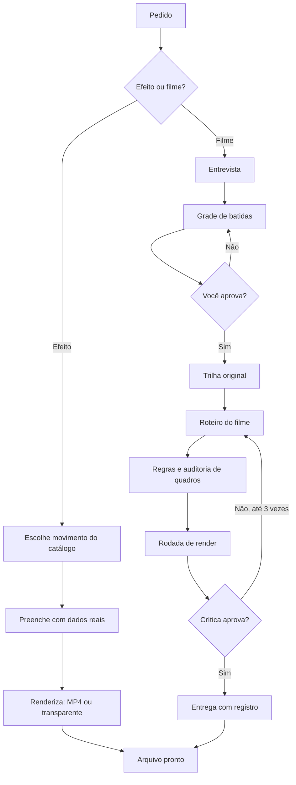

# Manual do Diretor de Movimento

Versão 0.1.0

## Do que se trata

O Diretor de Movimento é uma skill (um conjunto de instruções e programas que o agente de IA lê) que cria vídeos animados com a identidade da sua empresa. Você descreve o que precisa; o agente escreve a animação, gera o vídeo e entrega o arquivo.

Ele faz dois tipos de trabalho:

- **Movimentos:** efeitos curtos, de 2 a 6 segundos, como um contador de inscritos, um post curtido, um terminal executando um comando ou um gráfico crescendo. Você os coloca dentro do vídeo que já edita, no CapCut, Premiere ou DaVinci.
- **Filmes:** um vídeo inteiro, de 10 a 40 segundos, com cenas cortadas no ritmo de uma trilha musical original, pronto para postar.

## Por que existe

Vídeo animado de qualidade costuma exigir um editor, um motion designer ou horas de ajuste em programas pesados. Aqui o trabalho vira texto: a animação é escrita como página web, o computador "filma" essa página quadro a quadro e junta tudo em um arquivo. O resultado sai igual toda vez, usa as cores, a fonte e o logo da sua marca e leva minutos, não dias.

## Onde fica cada coisa

| Pasta ou arquivo | O que tem |
|---|---|
| `SKILL.md` | as instruções que o agente lê |
| `scripts/` | os programas que renderizam, medem e entregam |
| `assets/movimentos/` | a biblioteca de efeitos |
| `assets/temas/` | os três estilos visuais |
| `catalogo/` | prévias e lista de todos os movimentos (`galeria.html` abre no navegador) |
| `references/` | guias de direção, regras de animação, som e crítica |
| `~/diretor-de-movimento/` | sua pasta de trabalho: marcas, projetos e o GSAP |

## Quando usar

Use quando precisar de um vídeo animado e não tiver um editor ou o tempo para fazê-lo. Bom para anúncio, vídeo de lançamento, apresentação de produto, reels, shorts e efeitos para colocar em vídeo falado.

Não use para editar vídeo filmado (cortar, legendar fala), para vídeos com pessoas ou voz, nem quando precisar de uma animação 3D complexa.

## Como instalar

1. Instale o que o computador precisa (uma vez só):
   - Node 22 ou mais novo: https://nodejs.org (baixe a versão "LTS" e instale como um aplicativo qualquer).
   - FFmpeg: no Mac, `brew install ffmpeg` (precisa do Homebrew, https://brew.sh).
   - Google Chrome: https://www.google.com/chrome/
2. Instale a skill: baixe `diretor-de-movimento.skill` da release do GitHub e envie na área de Skills do seu aplicativo de IA; ou copie a pasta para `~/.claude/skills/diretor-de-movimento/`.
3. Peça ao agente: "Rode a verificação do ambiente do diretor-de-movimento com correção". Ele confere tudo e baixa o GSAP.
4. Para ter certeza: "Rode o autoteste do diretor-de-movimento". Se terminar com "Tudo certo", pode usar.

## Como usar

**Um efeito (movimento):**

1. Diga o que precisa: "Faz um contador de inscritos chegando a 12 mil, em vertical, com fundo transparente."
2. O agente escolhe o movimento do catálogo e usa os seus dados (número, texto).
3. Ele gera o arquivo e mostra um quadro para você conferir.
4. Você coloca o arquivo no seu editor.

**Um filme:**

1. O agente faz até seis perguntas: para que serve, quanto dura, formato, clima, o momento que as pessoas vão lembrar, de onde vêm os números.
2. Ele monta o plano (a grade de batidas): uma tabela com cada cena, o tempo e o som. **Você aprova antes de ele animar qualquer coisa.**
3. Ele cria a trilha, escreve o filme, confere as regras e gera uma primeira versão.
4. Ele avalia a versão (gancho, marca, movimento, legibilidade, ritmo e acabamento), corrige e repete, no máximo três vezes.
5. Entrega o vídeo e um registro do que foi feito.

## Quadro esquemático

## Como atualizar

1. Quando sair uma versão nova, baixe o novo `diretor-de-movimento.skill` da release e envie de novo (substitui o anterior), ou rode o `rsync` do README.
2. Confira o hash do pacote (`shasum -a 256 diretor-de-movimento.skill`) com o da descrição da release.
3. Rode o autoteste de novo.

Suas marcas e projetos ficam na pasta de trabalho e não são apagados na atualização.

## Perguntas comuns

**O vídeo demora a sair. É normal?** Sim. São centenas de quadros gerados um a um. Rascunhos são mais rápidos; a versão final leva mais tempo.

**Posso usar minha própria música?** A trilha é gerada pela skill, para não ter problema de direito autoral. Se quiser outra, adicione a sua no editor depois da entrega.

**Posso usar o vídeo comercialmente?** O vídeo é seu, com a sua marca. Confira apenas se logo, fontes e telas que você forneceu podem ser usados em vídeo.

**O que são "marca" e "tema"?** A marca é a sua identidade (cores, fonte, logo). O tema é o estilo do vídeo (vidro, estúdio, editorial); o mesmo roteiro muda de atitude quando você troca o tema.

**Faltou um efeito que eu preciso.** Veja `BACKLOG.md`; peça ao agente para criar o movimento novo seguindo `references/10-novos-movimentos.md`.
