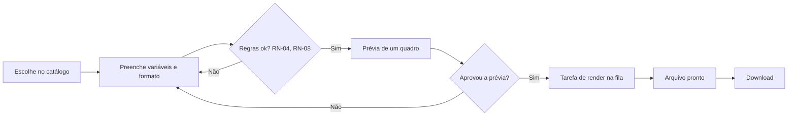
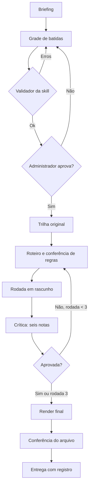
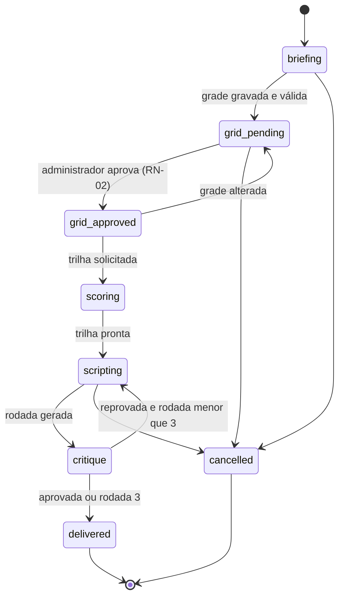
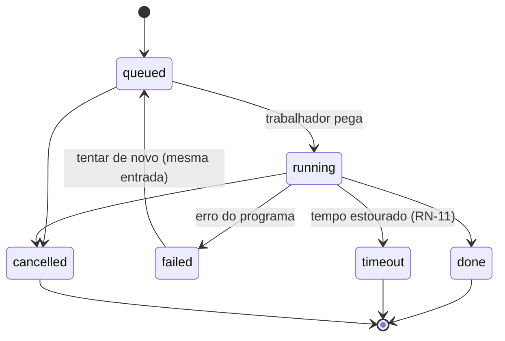

# 05 — Fluxos e estados

## Fluxo de um movimento

## Fluxo de um filme

## Estados do filme (`ProjectStatus`)

## Estados de uma tarefa de render (`RenderStatus`)

## Estados de um movimento (`ClipStatus`)

`queued` → `rendering` → `done`, ou `failed` (volta a `queued` ao tentar de novo).
