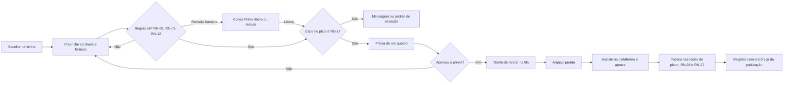
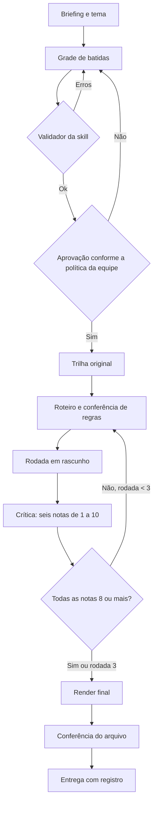
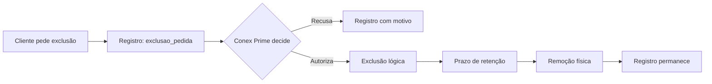
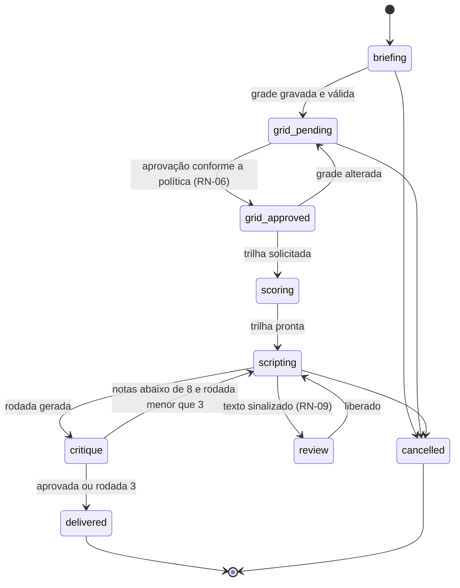
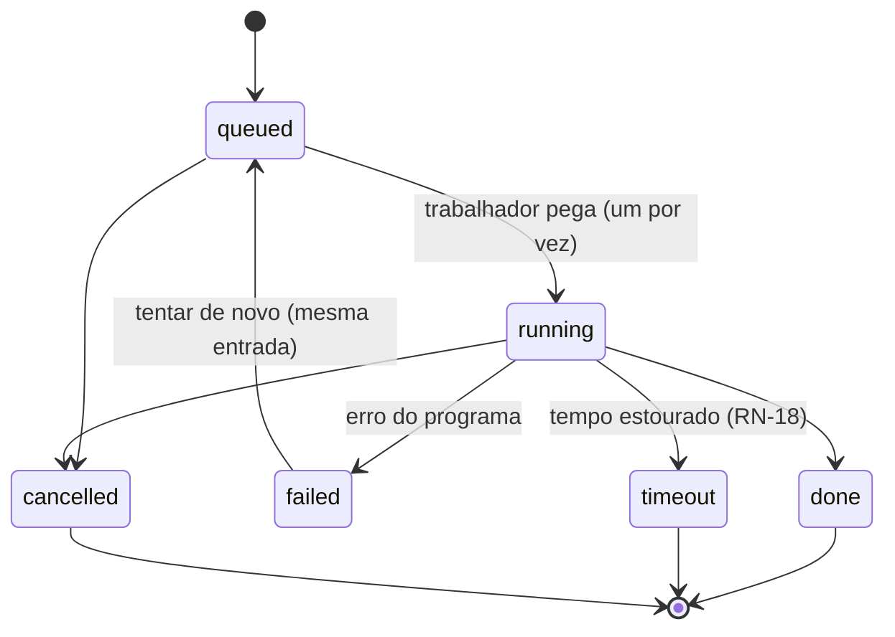

# 05 — Fluxos e estados

## Fluxo de um efeito

## Fluxo de um filme

## Fluxo de exclusão

## Estados do filme (`ProjectStatus`)

## Estados de uma tarefa de render (`RenderStatus`)

## Estados de um efeito (`ClipStatus`)

`queued` → `rendering` → `done`, ou `failed` (volta a `queued` ao tentar de novo), ou `review` (texto sinalizado, RN-09; sai para `queued` quando a Conex Prime libera).

## Estados de uma publicação (`PublicationStatus`)

`draft` → `scheduled` (se tiver data) → `publishing` → `published`, ou `publishing` → `failed` (tenta de novo até o limite; depois fica `failed` e abre ticket para a Conex Prime), ou `scheduled` → `cancelled`.

## Estados de um pedido de exclusão (`DeletionStatus`)

`requested` → `authorized` → `executed`, ou `requested` → `refused`.
